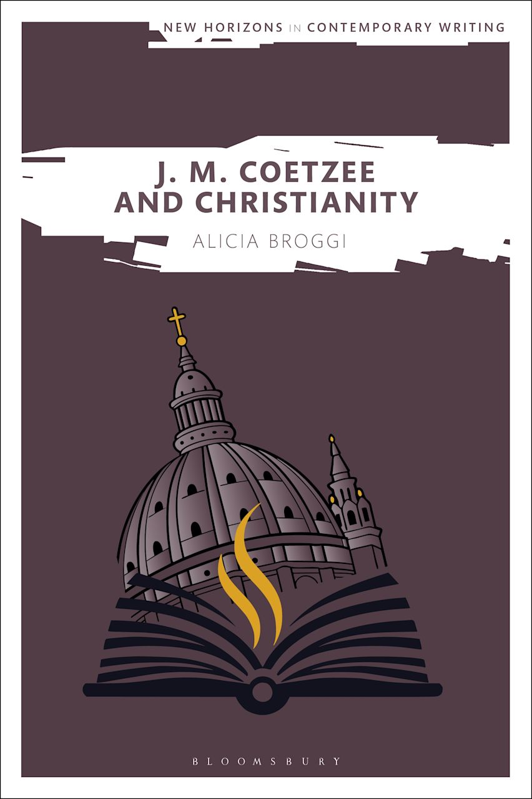

**Good writing is good thinking.** I am a writer, researcher, and editor who helps people turn complex ideas, nuanced stories, and ambitious projects into clear and compelling prose.

My work spans scholarly publishing, technology journalism, analytical essays, and travel writing. With a background in postgraduate research in the UK, the US, and Germany, I combine rigorous research with an ability to make complex subjects accessible and engaging.

As an editor, I help writers find the clearest, strongest expression of their ideas. Whether advising on a piece from the start or refining an existing manuscript, I help people communicate ideas that matter with clarity, conviction, and purpose.

---

### Reviews & Testimonials

> “I hired Alicia Broggi to content and line edit my memoir about my son's autism and our family's transformation. Within a few weeks, she'd become a true partner and co-creator. In the content edit, she cut what was repetitive, restructured the story so it flowed better, and improved the clarity for readers. In the line edit, she was meticulous about every comma, sentence, and word choice. She was also responsive and insightful the whole way through.
> 
> I've worked with both human and AI editors, and Alicia is one of the very best. She reads past the words to how they'll make people feel. Readers don't remember sentences. They remember how a book made them feel.
> 
> I couldn't have asked for a better partner, and I recommend her without reservation.”
> 
> — **Esther Lee Cruz**, *_Memoir Client, Hopeward*_

---

### Selected Publications

  

> #### **J. M. Coetzee and Christianity**
> *Bloomsbury Academic, March 2026*
> 
> A research monograph examining the structural intersections of literature, foundational cultural ethics, and belief systems within modern societal frameworks.
> 
> [Available from Bloomsbury](https://www.bloomsbury.com/us/j-m-coetzee-and-christianity-9781350500235/)

---

### Essays & Features

*   **Editorial Features** — [Three Frontier Architects](https://www.linkedin.com/pulse/three-frontier-architects-harvardintech-ubdie/)
*   **Editorial Features** — [AI's Hidden Architects](https://www.linkedin.com/pulse/ais-hidden-architects-harvardintech-liafe/)
*   **Industry Panels** — [Reflections on the Recent Leaders in Engineering Panel](https://www.linkedin.com/pulse/reflections-recent-leaders-engineering-panel-harvardintech-jkoqc/)
*   **Analytical Essays** — [“Human Writing” in the Age of Artificial Intelligence](https://docs.google.com/document/d/1HhhsjOJrgpGvuDz8DuRvbZuXJEsw09_JhcePR1nQFHc/edit?usp=sharing) (*Out for Review*)

---

### Peer-Reviewed Articles & Media

*   **Journal Article** — [“What Does it Mean to Speak of [–––]?” Rudolf Bultmann, Biography, and J. M. Coetzee’s *Life & Times of Michael K* (1983)](https://academic.oup.com/res/article-abstract/69/289/336/4745981) — *The Review of English Studies*
*   **Journal Article** — [“A Language I Have Not Unlearned”: Cultivating an Historical Awareness of J.M. Coetzee’s Engagement with Christianity](https://academic.oup.com/litthe/article-abstract/32/4/452/5056966) — *Literature and Theology*
*   **Audio Production** — [Literate Podcast](https://literatepodcast.com/) — A podcast about the “best” books, co-created and co-produced with Erica Lombard

---

### Academic Background

*   **D.Phil. in English** — University of Oxford (Clarendon Scholar)
*   **M.Sc. in English** — University of Edinburgh
*   **Master's Degree** — Wheaton College
*   **Undergraduate Degree** — Wheaton College

---

### Contact & Collaboration

For research collaborations, editorial work, or inquiries regarding my writing, please feel free to reach out:

[LinkedIn](https://www.linkedin.com/in/aliciabroggi/) &nbsp;&nbsp;•&nbsp;&nbsp; [Email](mailto:aliciabroggi@gmail.com)
